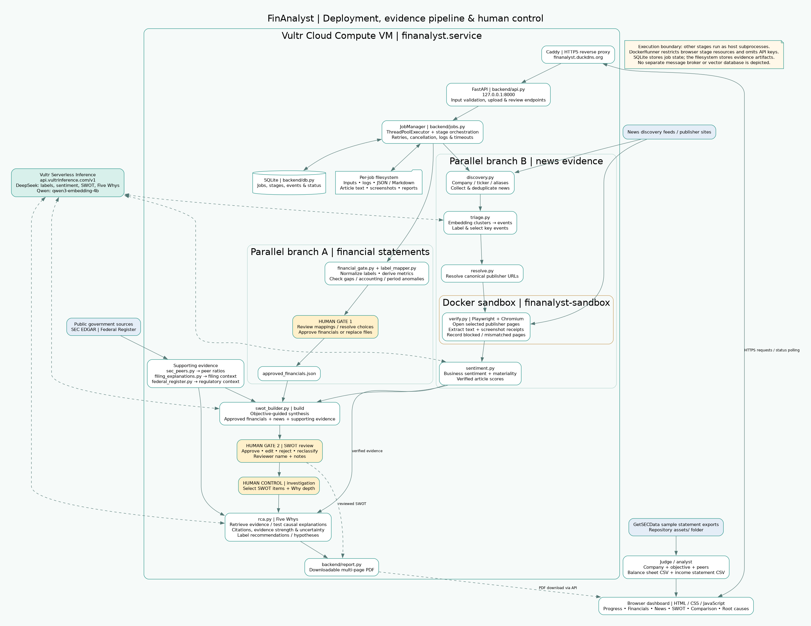

# FinAnalyst — Evidence-Grounded Financial Intelligence

> **AI does the analytical laundry — you keep the judgment.**

Built solo by **Adeel Kamal** for the **Vultr: Agent Rush Hackathon** on [lablab.ai](https://lablab.ai/event/vultr-agent-rush-hackathon).

- **Live Application:** [https://finanalyst.duckdns.org/ui](https://finanalyst.duckdns.org/ui)
- **Demo Video:** Included in submission (`finanalyst-demo.mp4`)
- **Check below on HOW TO USE.
- **STARY BY:** Goto assets in the repository and select a income sheet and balance sheet.
---

## What is FinAnalyst?

Financial analysis traditionally demands hours of manual, repetitive work: cleaning financial statements, scraping scattered news, verifying paywalled sources, mapping peer ratios, and attempting to diagnose why metrics moved.

**FinAnalyst** removes that heavy lifting. It assembles an evidence-grounded starting position by running two parallel branches:

1. **Financial Branch:** Ingests balance sheets and income statements, normalizes rows into standardized accounting fields, computes key ratios, flags anomalies, and awaits human sign-off.
2. **News & Market Branch:** Discovers thousands of recent articles, clusters them via embeddings, resolves original publisher URLs, verifies text and captures screenshots inside a sandboxed browser, and scores business sentiment.

Both branches converge at an AI-generated SWOT draft. Once reviewed and adjusted by the analyst, any item can be selected for a **Five Whys root-cause analysis** backed by verified article excerpts, SEC filing explanations, and peer filings.

---

## Data Sources & Provenance

FinAnalyst prioritizes auditability and open financial data standards:

- **Sample Financial Statements (Balance Sheet & Income Statement):** The demonstration statements used across testing and the demo video (e.g., Google, Amazon, Ford, General Motors) were downloaded via [GetSECData](https://www.getsecdata.com/), which exports clean, multi-year standardized SEC 10-K financial statement tables.
- **Peer Financial Filings:** Directly pulled from official SEC EDGAR public XBRL / company facts endpoints (`data.sec.gov`).
- **Regulatory Notices:** Queried live from the official US Government Federal Register API (`federalregister.gov`).
- **News Coverage:** Aggregated across top-tier business outlets and canonical publishers, verified by capturing full-page text and screenshot receipts.

---

## Powered by Vultr

FinAnalyst is designed around Vultr's infrastructure:

- **Vultr Cloud Compute:** Hosts the FastAPI orchestration engine, SQLite state machine, and a Docker sandbox container (`finanalyst-sandbox`) that safely visits publisher URLs and captures page screenshots.
- **Vultr Serverless Inference (`https://api.vultrinference.com/v1`):**
  - **`qwen3-embedding-4b`:** Dense semantic embeddings to cluster raw news articles into discrete news events.
  - **`deepseek-v4.1-flash-1017`:** Event labeling, article sentiment scoring, SWOT draft proposal, and Five Whys causal reasoning.

---
# FinAnalyst — Judge Quick Start

## HOW TO USE.

## Option A: Inspect an Existing Analysis

Open All analyses and select the completed GOOGLE analysis if it is still available.

Explore these tabs:

- Financials
- News
- SWOT
- Comparison
- Root causes

Then download the PDF report.

This is the quickest walkthrough and avoids waiting for a fresh news run.

> Do not delete shared demonstration jobs.

## Option B: Run a New Analysis

### 1. Download the Sample Files

Open the repository’s [assets directory](https://github.com/Adeel-lab/financial-pipeline-vultr/tree/main/assets).

Open each CSV in GitHub and use Download raw file. Upload the downloaded CSV—not the GitHub HTML page.

### 2. Open New Analysis

Enter the following example details:

| Field | Value |
|---|---|
| Company | Alphabet |
| Ticker | GOOGL |
| Aliases | Google |
| Peer tickers | META, AMZN |
| Statement frequency | Annual |

Suggested objective:

> Assess Alphabet’s current strategic position, key risks, and readiness for future growth in AI, cloud, advertising, and regulatory pressure.

### 3. Upload the Financial Statements

Upload these two files into their corresponding fields:

| Upload Field | File |
|---|---|
| Balance sheet | `GOOGL_balance_sheet_annual_2016_2025_cleaned.csv` |
| Income statement | `GOOGL_income_statement_annual_2016_2025_cleaned.csv` |

Configure the remaining settings:

- Set currency and units to match the source data.
- Do not assume the scale from the filename.
- If the scale is unclear, select Not sure and inspect the resulting warnings.
- Leave the optional peer JSON empty when using peer tickers.
- Keep AI enabled.
- Leave other settings at their defaults unless needed.

### 4. Start the Analysis

Start the analysis and monitor Progress.

Financial validation and news collection begin in parallel.

### 5. Review and Approve the Financials

In Financials:

1. Inspect the proposed mappings.
2. Review warnings.
3. Resolve any ambiguous row choices.
4. Approve only after checking the results.

If the financial gate is blocked, correct and replace both files.

> A financial-approval pause is expected—not a crash.

### 6. Wait for the SWOT Draft

The news pipeline and approved financials converge into a SWOT draft.

Browser restrictions may prevent some publisher pages from being verified. Inspect stage logs and recorded statuses for details.

### 7. Review the SWOT

In SWOT, you can:

- Approve proposals.
- Edit statements.
- Reject proposals.
- Reclassify items.

Enter a reviewer name, add notes as needed, and save the review.

### 8. Run a Root-Cause Investigation

Select an accepted SWOT issue, request a Why/root-cause investigation, and choose the analysis depth.

Inspect:

- The Five Whys chain.
- Supporting citations.
- Stated uncertainty.
- Labelled recommendations.

### 9. Download the Report

Download the PDF report after the desired investigation is finished.

## Required File Format for the Financial Branch

Upload **two** UTF-8 text CSV files for the same company:

1. A balance sheet.
2. An income statement.

Do not upload PDF reports, screenshots, or XLSX files into these fields. Use the supplied samples first.

### CSV Structure

- Rows represent financial line items.
- Column headers represent period dates.
- Cells contain numeric values.
- Labels containing commas must remain quoted.
- Missing values should remain blank.
- Currency, units, scope, and period frequency should be consistent.
- Do not combine different companies or mix annual and quarterly statements in a pair.

Example layout, using illustrative values only:

```csv
Line Item,2025-12-31,2024-12-31
Revenue,1000,900
Cost of Goods and Services Sold,600,550
```

> The API permits both statement files or neither, but rejects a single-file upload. Omitting both skips the uploaded-financial branch. Upload both to test the full financial-plus-news workflow.

## Available Sample Pairs in `assets/`

### Alphabet

- Balance sheet: `GOOGL_balance_sheet_annual_2016_2025_cleaned.csv`
- Income statement: `GOOGL_income_statement_annual_2016_2025_cleaned.csv`

### Amazon

- Balance sheet: `AMZN_balance_sheet_annual_2020_2026 (1).csv`
- Income statement: `AMZN_income_statement_annual_2020_2026.csv`

### Ford

- Balance sheet: `F_balance_sheet_annual_2020_2026_cleaned.csv`
- Income statement: `F_income_statement_annual_2020_2026_cleaned.csv`

### General Motors

- Balance sheet: `GM_balance_sheet_annual_2020_2026_cleaned.csv`
- Income statement: `GM_income_statement_annual_2020_2026_cleaned.csv`

### Tesla

- Balance sheet: `TSLA_balance_sheet_annual_2020_2026.csv`
- Income statement: `TSLA_income_statement_annual_2020_2026.csv`

## Reviewer Requirements and Limitations

- The hosted demo requires a browser and sample files—not a local Python/Docker setup or personal API keys.
- Hosting credentials are configured server-side.
- New runs use recent coverage, so counts and conclusions may differ from the recorded demo.
- There is no guaranteed runtime. News volume, publisher access, inference availability, and human review affect completion.

## Data Provenance and Support

| Data | Source |
|---|---|
| Statement inputs | GetSECData |
| Peer filings | SEC EDGAR |
| Regulatory context | Federal Register |


Contact: [adeelkamal97@gmail.com](mailto:adeelkamal97@gmail.com)

## Architecture Diagram

The accompanying diagram covers:

- Browser → Caddy → FastAPI → JobManager.
- Parallel financial and news workflows.
- Human approval and review gates.
- Supporting public-data modules.
- Vultr inference.
- Docker browser verification.
- SQLite job state.
- Per-job evidence files.
- PDF output.

The optional no-upload path is not expanded in the main diagram.

Supporting evidence retrieval is shown as a logical component—not as a claim that every module is a separately scheduled service.

## Verification Basis

| Area | Verification Source |
|---|---|
| Sample filenames | GitHub `assets/` directory |
| Upload validation | `backend/api.py` |
| Workflow and artifact handling | `backend/jobs.py` |
| Sandbox boundaries | `backend/runner.py` |
| UI fields | Supplied `ui/index.html` |

Deployment and supporting-module context are based on the supplied project materials. This is not a fresh uptime or end-to-end execution test.

## Architecture & Pipeline Flow

```text
 Upload Financial Statements + Company + Objective
         |
         +--> financial_gate --report-only --> [Human Approval] --> approved_financials.json
         |
         +--> discovery -> triage -> resolve -> verify (Docker) -> sentiment
                                          |
                              [Both Branches Converge]
                                          |
                                   swot_builder build
                                          |
                                 [Human SWOT Review]
                                          |
                               Five Whys RCA (rca.py)
                                          |
                               Downloadable PDF Report
```

---
## System Architecture

FinAnalyst runs on Vultr Cloud Compute, with two parallel workflows:
financial statement validation and evidence-based news analysis.

The workflows converge into an objective-guided SWOT draft after
financial approval. The analyst reviews the SWOT and selects issues
for Five Whys root-cause analysis.



[Open the full-size diagram](assets/FinAnalyst_architecture.png)
· [View the PDF version](assets/FinAnalyst_architecture.pdf)
## Quick Start (Local Setup)

### 1. Requirements
- Python 3.10+
- Playwright Chromium (`python -m playwright install chromium`)
- Optional: Docker (for sandboxed article verification)

### 2. Installation
```bash
git clone [https://github.com/Adeel-lab/financial-pipeline-vultr.git](https://github.com/Adeel-lab/financial-pipeline-vultr.git)
cd financial-pipeline-vultr
pip install -r requirements-backend.txt
```

### 3. Environment Variables
Create a `.env` file or export in terminal:
```bash
export VULTR_INFERENCE_BASE="[https://api.vultrinference.com/v1](https://api.vultrinference.com/v1)"
export VULTR_INFERENCE_API_KEY="your-vultr-api-key"
export VULTR_CHAT_MODEL="deepseek-v4.1-flash-1017"
export VULTR_EMBED_MODEL="qwen3-embedding-4b"
export FINANALYST_SANDBOX="docker"  # or "local"
export SEC_USER_AGENT="Yourname you@example.com"

> **Note on Public Data APIs:** SEC filings (`data.sec.gov`) and Federal Register documents (`federalregister.gov`) are free public APIs and do not require paid API keys. The SEC only requires a standard descriptive `SEC_USER_AGENT` string as shown above.

```

### 4. Run
```bash
python app.py
```
Visit `http://localhost:8000/ui` for the web interface or `http://localhost:8000/docs` for Swagger API docs.

# FinAnalyst — Repository File Directory & System Architecture

This document outlines the purpose, role, and execution stage of every core file across the `financial-pipeline-vultr` repository.

---

## 1. Root Level

| File | Purpose |
|---|---|
| `app.py` | Primary FastAPI application entrypoint. Initializes routing, CORS, static UI mounts (`/ui`), and runs the Uvicorn web server. |
| `Dockerfile.sandbox` | Dockerfile for `finanalyst-sandbox`. Builds an isolated Linux container with Playwright/Chromium to safely open, scrape, and capture screenshots of publisher news pages without exposing host environment credentials. |
| `requirements-backend.txt` | Minimal Python dependency definitions for the FastAPI orchestrator and background services (`fastapi`, `uvicorn`, `httpx`, `jinja2`). |
| `.gitignore` | Prevents local SQLite databases (`jobs.db`), individual job directories (`jobs/`), and secrets (`.env`) from being committed. |
| `README.md` | Primary hackathon overview, architecture diagrams, live demo URLs, and quick-start instructions. |

---

## 2. `backend/` — Orchestration & Web API

The orchestration engine manages jobs asynchronously, schedules background tasks, and enforces human approval pauses.

| File | Purpose |
|---|---|
| `api.py` | FastAPI endpoint routers for starting jobs (`POST /jobs`), querying progress (`GET /jobs/{id}`), approving financial mappings (`POST /jobs/{id}/finance/approve`), reviewing SWOT drafts (`POST /jobs/{id}/swot/review`), running Five Whys (`POST /jobs/{id}/rca`), and downloading artifacts. |
| `jobs.py` | Core pipeline state machine. Manages concurrency semaphores, transitions stages, monitors cancellations/timeouts, mounts Docker containers for verification, and triggers the Five Whys RCA. |
| `runner.py` | Standardized runner interfaces (`LocalRunner` and `DockerRunner`). Manages subprocess lifecycles, execution timeouts, stdout/stderr logging, and process group isolation. |
| `report.py` | Generates the consolidated, multi-page downloadable PDF report summarizing financial metrics, verified news, SWOT tables, and root-cause trees. |
| `db.py` | Thread-safe SQLite database interface managing job states, pipeline event logs, and stage execution timestamps. |
| `config.py` | Central configuration file. Resolves directories (`jobs/`, `information_new/`, `planning/`), stage timeouts, worker pool sizes, and Docker limits from environment variables. |
| `env.py` | Environment variable loader. Ingests `.env` files and aliases `VULTR_*` credentials into standard keys (`LLM_API_KEY`, `LLM_BASE_URL`, `LLM_MODEL`) used across pipeline scripts. |

---

## 3. `information_new/` — News, Market & RCA Engine

Handles news aggregation, semantic clustering, web page verification, sentiment scoring, SEC filings, and the Five Whys causal reasoning.

| File | Purpose |
|---|---|
| `discovery.py` | **News Discovery Stage:** Searches and deduplicates news coverage across major business tiers, general media, and financial aggregators over a 1–90 day window. |
| `triage.py` | **Event Clustering & Ranking:** Converts articles into embeddings via Vultr Inference (`qwen3-embedding-4b`), performs leader clustering, labels event topics, and selects balanced opportunity/threat quotas across time buckets (24h, 7d, 30d). |
| `resolve.py` | **Publisher URL Resolution:** Traces aggregator links back to canonical publisher domains (Reuters, WSJ, CNBC, The Verge, etc.) and captures alternative source URLs. |
| `verify.py` | **Browser Verification (Sandboxed):** Executes in an isolated headless browser (or Docker sandbox). Opens resolved URLs, bypasses consent dialogs, extracts article text, validates title similarity, and saves full-page screenshot receipts. |
| `sentiment.py` | **AI Sentiment & Materiality:** Evaluates verified article texts with DeepSeek via Vultr Inference. Assigns sentiment scores (-1.0 to +1.0), detects market chatter, and tags corporate opportunities vs. threats. |
| `swot_builder.py` | **SWOT Drafting & Review:** Merges approved financial metrics, scored news events, SEC filing facts, and peer comparisons into 4 quadrants (Strengths, Weaknesses, Opportunities, Threats) guided by the user's objective. Also handles human review decisions (`approve`, `edit`, `reject`). |
| `rca.py` | **Five Whys Root-Cause Engine:** Investigates a chosen SWOT problem down through recursive "Why" cycles. Cross-examines verified news passages, SEC filing quotations, and financial ratios; isolates supported causes from hypotheses; and proposes actionable corrective steps. |
| `sec_peers.py` | **SEC EDGAR Peer Benchmarking:** Pulls 10-K US-GAAP numbers directly from the SEC EDGAR API (`data.sec.gov`) for peer tickers, normalizes balance sheets and income statements, and computes matching financial ratios. |
| `filing_explanations.py` | Extracts management discussions and explanations (MD&A) directly from recent SEC 10-K/10-Q filings. |
| `federal_register.py` | Queries the public Federal Register API (`federalregister.gov`) for relevant regulatory filings, antitrust inquiries, and compliance notices affecting the company. |
| `fin_metrics.py` | Mathematical calculations for standardized financial ratios (margins, liquidity, debt ratios, turnover, growth rates). |
| `company_profile.py` | Company metadata and entity alias resolver (e.g., mapping Google to Alphabet Inc. and ticker GOOGL). |
| `evidence_articles.py` | BM25-based lexical and passage retriever for matching verified news text against Five Whys queries. |
| `evidence_financials.py` | Converts approved financial statements into queryable factual assertions for root-cause reasoning. |
| `evidence_peers.py` | Formats peer comparison metrics into structured evidence blocks for the RCA prompt. |
| `evidence_filings.py` | Indexes and retrieves verbatim SEC filing quotes supporting specific "Why" steps. |
| `evidence_regulatory.py` | Extracts relevant government agency actions and Federal Register notices as RCA evidence. |

---

## 4. `planning/` — Financial Ingestion & Statement Validation

Validates raw financial CSVs, derives missing figures, and enforces accounting consistency.

| File | Purpose |
|---|---|
| `financial_gate.py` | **Financial Statement Gate:** Ingests raw balance sheets and income statements, normalizes accounting line items, calculates derivative rows, checks consistency across fiscal periods, and produces the human approval proposal. |
| `label_mapper.py` | Fuzzy and exact label matcher mapping diverse accounting taxonomies (US-GAAP, IFRS, custom internal labels) into standardized FinAnalyst fields. |
| `planning.py` | Contextual analysis and planning logic for structured financial summaries. |
| `llm_client.py` | HTTP client communicating with OpenAI-compatible endpoints (Vultr Serverless Inference) for structured JSON generation. |

---

## 5. `ui/` — Web Interface

| File | Purpose |
|---|---|
| `index.html` | Single-page web dashboard providing the full interactive interface: job creation forms, parallel progress timelines, financial approval gates, news exploration with screenshot receipts, SWOT revision controls, interactive Five Whys trees, and PDF export buttons. |


## Contact & Live Support

Built solo by **Adeel Kamal** for the Vultr: Agent Rush Hackathon.

If you encounter any issues accessing the live demo, running a test job, or have questions about the implementation, feel free to reach out directly:

- **Email:** adeelkamal97@gmail.com
- **GitHub Issues:** [github.com/Adeel-lab/financial-pipeline-vultr/issues](https://github.com/Adeel-lab/financial-pipeline-vultr/issues)
